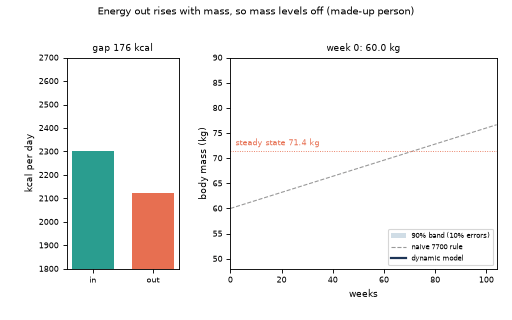
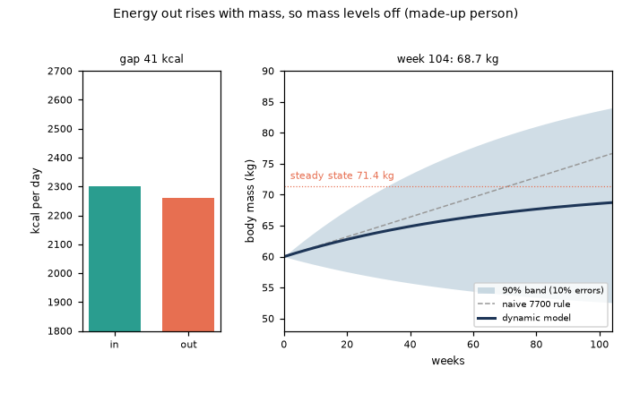
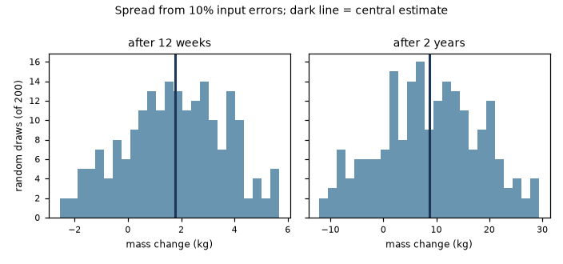
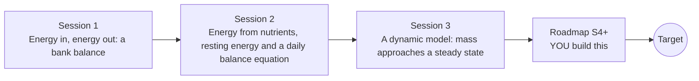

# opennutrition

[](https://github.com/KrunalPanchal1995/opennutrition/actions/workflows/ci.yml)   [](https://colab.research.google.com/github/KrunalPanchal1995/opennutrition/blob/main/sessions/session-01/lesson.ipynb) [](https://krunalpanchal1995.github.io/opennutrition/)

**Balance food energy against activity, like a bank account, in three sessions.**

opennutrition teaches how food energy and activity add up, from kilocalories to a dynamic model of body mass with honest error bars, using only Python and a browser. General education, not medical advice.

- **Start from zero.** Session 1 needs only school arithmetic; every term is explained.
- **See it move.** Every session ships a slider app that runs in the browser, with labelled graphs.
- **Know you got it right.** Each session ends with a checkpoint that prints PASS or FAIL against hand calculations.
- **Learn the limits.** Formulas here are population estimates; the sessions show how errors grow, not just how to compute.

[Target](#the-target) · [Who is this for](#who-is-this-for) · [Quick start](#quick-start) · [Sessions](#sessions) · [Roadmap](#roadmap) · [Contribute](#contribute) · [Explainer PDF](docs/explainer.pdf)

> **This repo is incomplete on purpose.** Sessions 1 to 3 are here and fully working. The finished Target below is a preview of what the community can build next. We show you the path, not the code. Sessions 4 and up are yours.

## The Target

A made-up person eats a little more than they use. On the left, two bars show energy in (fixed) and energy out, which creeps upward as body mass rises. On the right, body mass climbs and then levels off toward a steady state, while the naive straight-line rule keeps climbing. A shaded band shows how far the picture could be off if the food log and the resting-energy estimate are each wrong by up to ten percent: the band is wider than the effect. Your goal over the coming sessions: build that animation yourself, with the uncertainty band.



*Target: body mass approaches a steady state, with energy bars and an uncertainty band*



*Target, final frame: dynamic model, naive rule and uncertainty band*



*Spread of the answer from ten percent input errors, at 12 weeks and at 2 years*

Try it live:

- [Math Visual Studio (Studio home)](https://krunalpanchal1995.github.io/studio/)

How the Target was made is shown only as a path in [promo/roadmap.md](promo/roadmap.md).

## Who is this for
**secondary school to diploma / undergraduate (levels 3-5).** Topic area: Biology, Human Body and Health Science.

Prerequisites:

- School arithmetic and reading a line graph.
- Python 3.10 or newer; if `python --version` works, you are ready. PRIMER.md explains the rest.
- No prior GitHub, biology or programming experience is needed. This repo is not medical or dietary advice.

New to Python? Read [PRIMER.md](PRIMER.md) first (10 minutes).

## Quick start

No installation knowledge needed. You need [Git](https://git-scm.com/downloads) and [Python 3.10+](https://www.python.org/downloads/) (Windows: tick "Add Python to PATH"). On Mac and Linux type `python3` wherever this page says `python`.

```bash
git clone https://github.com/KrunalPanchal1995/opennutrition.git
cd opennutrition
python start.py 1
```

`start.py` creates a private environment, installs what is needed and runs Session 1 with its checkpoint. Next: `python start.py 2`, `python start.py 3`, or `python start.py test` to check everything. Only a checkpoint: `python start.py check 1`.

Three lines turn the idea of Sessions 2 and 3 into numbers (they work as they are): Save it as `try.py` and run it with `python start.py run try.py` (this uses the private environment, where NumPy is installed):

```python
import numpy as np
bmr = 10 * 60 + 6.25 * 165 - 5 * 20 - 161       # Mifflin-St Jeor, made-up woman (kcal/day)
label = 4 * 5 + 4 * 60 + 9 * 20                 # protein 5 g, carbohydrate 60 g, fat 20 g (kcal)
print(bmr, label)                               # -> 1370.25 440
```

Every session also opens in your browser with sliders (no install): [live apps](https://krunalpanchal1995.github.io/opennutrition/). Or use the Colab badge above for the notebook.

## Sessions

| # | Session | Model level | Time | Live app |
|---|---|---|---|---|
| 1 | [Energy in, energy out: a bank balance](sessions/session-01/README.md) | Level 1: conceptual interactive model | 60 min | [open](https://krunalpanchal1995.github.io/opennutrition/session-01/) |
| 2 | [Energy from nutrients, resting energy and a daily balance equation](sessions/session-02/README.md) | Level 2: mathematical engineering model | 75 min | [open](https://krunalpanchal1995.github.io/opennutrition/session-02/) |
| 3 | [A dynamic model: mass approaches a steady state](sessions/session-03/README.md) | Level 3: simulation and validation | 90 min | [open](https://krunalpanchal1995.github.io/opennutrition/session-03/) |

Each session follows the same six steps: A real-world problem, B concept and theory, C visual explanation, D interactive simulation, E worked example and experiment, F assessment and design challenge. Each ends with `checkpoint.py`, which prints `PASS` or `FAIL` against reference numbers. Session 3 also contains the real-world mini-project: **Plan a meal-and-walk schedule for a made-up person**.

## Architecture



| Folder or file | What is inside |
|---|---|
| `sessions/` | three sessions: README (A-F), `lesson.py`, notebook, live app, exercises, activity sheet, checkpoint |
| `promo/` | the Target: media, live links, and the roadmap (path only) |
| `docs/` | `explainer.tex` and the built `explainer.pdf` |
| `tests/` | runs every lesson and checkpoint headless |
| `start.py` | one command to set up and run anything |
| `QUALITY.md`, `RUBRIC.md` | the quality checklist and the scoring rubric |
| `.github/` | CI, PDF build, Pages deploy, issue and PR templates |

## Roadmap

| Milestone | What you will build | Difficulty |
|---|---|---|
| Session 4: Estimate the hidden intake bias from weigh-ins | Simulate 8 weeks of daily weigh-ins with 0.5 kg noise for a person whose true intake is above the logged value, then estimate the bias by least squares. | advanced |
| Session 5: Fat and lean compartments | A two-compartment model of body composition replacing the single 7700 kcal per kg constant. | advanced |
| Session 6: Rank the sources of uncertainty | A variance-based sensitivity study of intake error, BMR error and portion size error. | intermediate |
| Session 7: Weekly schedules with weekends | A model whose intake and walking differ between weekdays and weekends. | intermediate |
| Session 8: Reproduce the Target animation | An animated GIF with the energy-in and energy-out bars, the mass curve, the naive line and a shaded band. | advanced |

Full detail with a checkpoint per milestone: [promo/roadmap.md](promo/roadmap.md).

## Contribute
New to GitHub? Read [CONTRIBUTING.md](CONTRIBUTING.md); it starts from zero. Pick an issue labelled `good first issue`. Translations into Hindi, Telugu, Tamil and Malayalam are welcome.

<details>
<summary>Development</summary>

```bash
python start.py test        # runs every lesson and checkpoint
```
Lessons use `# %%` cell markers so they open as notebooks in VS Code. See [QUALITY.md](QUALITY.md) for the standard every session meets.
</details>

## License
MIT. See [LICENSE](LICENSE). Media in `promo/media` is (c) Krunal Panchal, CC BY 4.0.

## Acknowledgments
Part of the [PAN IIT OSS](https://hellofoss.tech-iitb.org/projects) open-source teaching collection, modelled on the structure of [openspline](https://github.com/openspline/openspline). Built on ideas from the Math Visual Studio at https://krunalpanchal1995.github.io/studio/.
