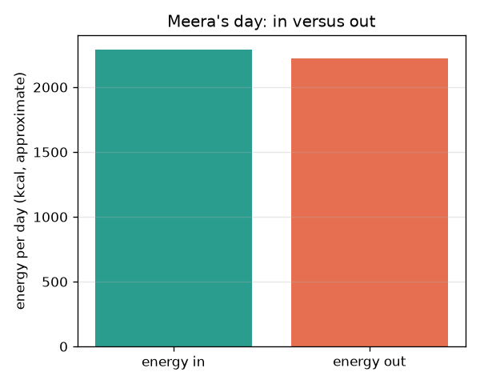
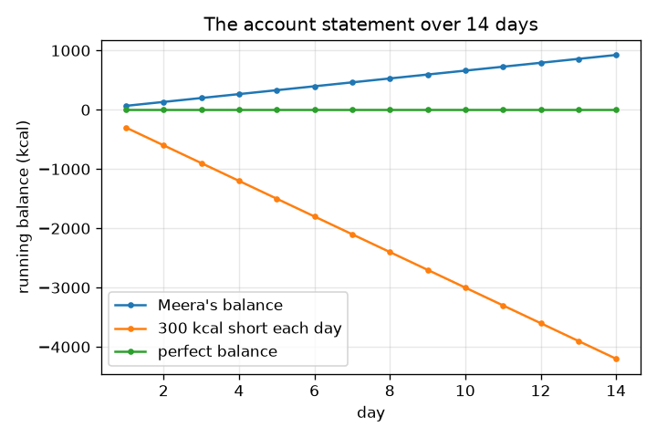

# Session 1: Energy in, energy out: a bank balance

*Level 1 (conceptual interactive model) · about 60 minutes · opennutrition*

> This is a simplified educational model. It is not a validated design tool and must not be used for real structures, electrical installations, vehicles, industrial processes or medical decisions.

**Prerequisites**

- School arithmetic: multiplying and adding.
- You have read PRIMER.md and run `python start.py 1` once.

**Learning objectives.** After this session you can:

- Explain energy balance as energy in minus energy out, like a bank balance.
- Convert between kilocalories and kilojoules (1 kcal = 4.184 kJ).
- Estimate energy out from an activity table: energy = MET x mass x hours (approximate).
- Read a running-balance graph and say what its slope means.

## A. Real-world problem
Food carries energy and the body spends energy all day, even asleep. If more comes in than goes out the balance is positive; if less, it is negative, exactly like money in a bank account. Can we put numbers on a day and see the balance? This is general education only, not medical or dietary advice. The people are made up. Values for foods and activities are rounded textbook values and are approximate.

## B. Concept and theory
Energy is measured in kilocalories (kcal, also called Calories on food packs) or kilojoules (kJ): 1 kcal = 4.184 kJ. Energy in comes from food. Energy out is the energy the body spends on staying alive, moving and digesting. A common textbook estimate for activity is energy (kcal) = MET x body mass (kg) x time (hours), where a MET value says how many times the resting rate an activity uses; one MET is about one kcal per kg per hour. The daily balance is energy in minus energy out; adding balances day by day gives a running total, the account statement. All values are approximate and differ between people.

| Symbol | Meaning | Unit |
|---|---|---|
| E_in | energy in from food | kcal per day |
| E_out | energy out from the body and activities | kcal per day |
| B | daily balance, E_in - E_out | kcal per day |
| MET | activity intensity as a multiple of resting rate | no unit |
| m | body mass | kg |
| t | time spent on an activity | hours |

**Assumptions**

- This is general education, not medical or dietary advice.
- Food and MET values are rounded, approximate textbook values.
- The model person is made up (60 kg) and every day is the same.
- The 24 hours of the day are split between the listed activities.

$$ 1\ \mathrm{kcal}=4.184\ \mathrm{kJ} $$

$$ E_{\mathrm{out}}\approx\sum_{\text{activities}}\mathrm{MET}\times m\times t $$

$$ B = E_{\mathrm{in}}-E_{\mathrm{out}},\qquad \text{running total after } n \text{ days}=\sum_{i=1}^{n}B_i $$

## C. Visual explanation
The first figure shows Meera's day (a made-up person) as two bars, energy in and energy out. They are close, so her balance is small. The second figure plots the running balance over 14 days for three cases: Meera's own small balance, a constant shortfall of 300 kcal a day, and a perfect balance of zero. Each line is straight because the same amount is added every day, and its slope is the daily balance.

*Meera's day: energy in against energy out (approximate values).*

*Running balance over 14 days: the slope is the daily balance.*

## D. Interactive simulation
Run the lesson (`python start.py 1`), then open the live app: [Session 1: energy in against energy out](https://krunalpanchal1995.github.io/opennutrition/session-01/) (or `app.html` in this folder). Move the intake, walking and cycling sliders and watch the two bars. Then open the running-balance graph and see how the line tilts when the daily balance changes.

**Challenge.** Bring the daily balance to within 50 kcal of zero while eating at least 2000 kcal.

## E. Worked example and experiment
**Problem.** How much energy does 1 hour of walking use for a 60 kg person, how many kilojoules is that, and how many bananas of food energy is it?

1. Walking has MET 3.5 (approximate). Energy = 3.5 x 60 kg x 1 h = 210 kcal.
2. In kilojoules: 210 x 4.184 = 878.64, about 879 kJ.
3. One medium banana is about 105 kcal (approximate), so 210 / 105 = 2 bananas.

**Answer.** About 210 kcal (about 879 kJ), roughly two bananas. All three numbers are approximate.

**Experiment.** Read a packet label that lists both kJ and kcal. Multiply the kcal by 4.184 and compare with the printed kJ; small differences come from rounding. Then keep a diary of what a made-up person (or you, for practice only) eats and does in a day and add it up. Real energy use differs from the MET table, which averages over many people, and food energy differs from the table too, so treat the result as an estimate.

## F. Assessment and design challenge
**Question type A: Conceptual.** Meera sleeps and does nothing else for 8 hours. Is her energy out zero? Explain, and give the table estimate for a 60 kg person.

Hint

Sleeping has a MET value just below 1.

Step-by-step solution

No. The body keeps working while asleep (heart, breathing, repair, keeping warm). With MET 0.95, energy = 0.95 x 60 x 8 = 456 kcal. Energy out is never zero, which is why the balance is not simply 'food minus exercise'.

**Question type B: Numerical.** A pack says 1500 kcal. How many kilojoules is that? Another day a person eats 2000 kcal and uses 2300 kcal: what is the balance and what is the running total after 7 days?

Hint

Multiply by 4.184, then multiply the daily balance by 7.

Step-by-step solution

1500 x 4.184 = 6276 kJ. Balance = 2000 - 2300 = -300 kcal per day; after 7 days the running total is 7 x (-300) = -2100 kcal. Sanity check: the units are kcal and the sign is negative because less came in than went out.

**Question type C: Graph and simulation interpretation.** In the running-balance graph, what is the value of the '300 kcal short each day' line after 14 days, and what does the slope of a line mean?

Hint

Slope is rise over run: kcal per day.

Step-by-step solution

After 14 days the line is at 14 x (-300) = -4200 kcal. The slope of each line is the daily balance in kcal per day: steeper means a bigger daily surplus or shortfall, flat means balance.

**Question type D: Design and optimisation challenge.** Meera's day gives a balance of +66 kcal. By swapping half an hour of sitting for walking, can she bring it to zero? Show the working and state the assumption.

Hint

Walking uses 3.5 MET and sitting 1.3 MET; find the extra kcal per hour for 60 kg.

Step-by-step solution

Extra energy per hour of walking instead of sitting = (3.5 - 1.3) x 60 = 132 kcal. Half an hour gives 66 kcal. So her energy out rises from 2223 to 2289 kcal, which equals her 2289 kcal in, and the balance is zero. Assumption: the MET table is exact for her; in reality it is only an estimate, so the true balance is uncertain.

Score yourself with [RUBRIC.md](../../RUBRIC.md). Print the [activity sheet](activity_sheet.md) to work on paper.

## Common misconceptions
| Common misconception | What is actually true |
|---|---|
| Energy out is only exercise. | Most energy out is the body running itself, even at rest; exercise adds on top. |
| A kilocalorie and a Calorie are different. | A food Calorie is a kilocalorie. Labels may also give kilojoules; 1 kcal = 4.184 kJ. |
| The table values are exact. | They are rounded averages; real foods and real people differ. |

## Glossary
- **energy balance**: energy in minus energy out
- **kilocalorie (kcal)**: unit of food energy; 1 kcal = 4.184 kJ
- **kilojoule (kJ)**: SI unit of energy often printed on labels
- **MET**: activity intensity as a multiple of the resting rate
- **running balance**: the total of daily balances so far

## Finish
1. Do the three coding tasks in [exercises.md](exercises.md).
2. Run `python start.py 1` again after your changes. It ends with the checkpoint; when it prints `PASS`, you are done. (Checkpoint only: `python start.py check 1`.)

Next: [Session 2](../session-02/README.md)
