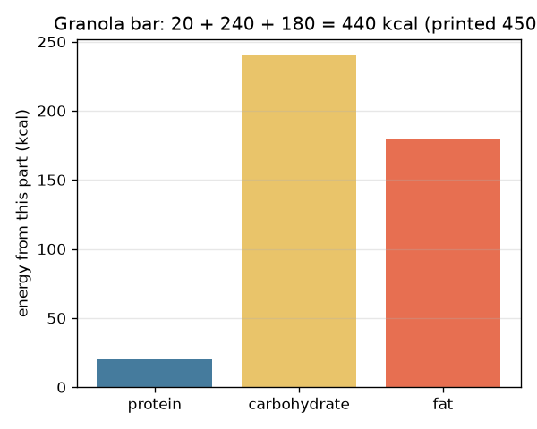
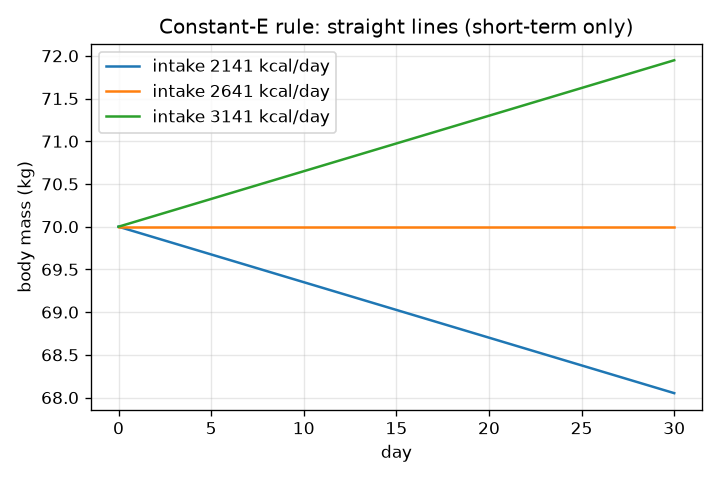

# Session 2: Energy from nutrients, resting energy and a daily balance equation

*Level 2 (mathematical engineering model) · about 75 minutes · opennutrition*

> This is a simplified educational model. It is not a validated design tool and must not be used for real structures, electrical installations, vehicles, industrial processes or medical decisions.

**Prerequisites**

- Session 1: kilocalories, balance and the running total.
- Reading a simple equation with several terms.

**Learning objectives.** After this session you can:

- Compute energy from grams: protein 4, carbohydrate 4, fat 9 kcal per gram.
- Check a label's printed kcal against the sum from grams and explain small differences.
- Estimate resting energy with the Mifflin-St Jeor equation and total use with an activity factor, stating its limits.
- Use the difference equation M[n+1] = M[n] + (I - E) / 7700 and say why it is only a short-term approximation.

## A. Real-world problem
A food label lists grams of protein, carbohydrate and fat and also a number of kilocalories. Do they agree? And how many kilocalories does a person use per day, so a day of meals can be balanced against a given activity plan? This is general education only, not medical or dietary advice. The people are made up. The formulas are population estimates and an individual can differ a lot.

## B. Concept and theory
Energy from food is estimated with general factors: 4 kcal per gram of protein, 4 per gram of carbohydrate and 9 per gram of fat. Printed labels use more detailed factors and rounding, so a small difference from the sum is normal. Resting energy (basal metabolic rate, BMR) can be estimated with the Mifflin-St Jeor equation: BMR = 10 m + 6.25 h - 5 a + s, with s = +5 for males and -161 for females. It was fitted to groups of people; for one person the real value can be quite different, so it is a starting guess, not a measurement. Total daily energy use (TDEE) is the BMR times an activity factor (PAL); common textbook values are 1.2, 1.375, 1.55 and 1.725 from sedentary to active. A rough short-term rule says that about 7700 kcal of surplus adds about 1 kg of body mass, giving the difference equation M[n+1] = M[n] + (I - E) / 7700 with I and E held constant. The body adapts when mass and activity change, so this rule is only a short-term approximation and worsens over longer times.

| Symbol | Meaning | Unit |
|---|---|---|
| P, C, F | protein, carbohydrate and fat in a food | g |
| m | body mass | kg |
| h | height | cm |
| a | age | years |
| s | sex constant (+5 male, -161 female) | kcal/day |
| PAL | activity factor | no unit |
| I, E | energy in and energy used per day | kcal/day |
| M[n] | body mass on day n | kg |

**Assumptions**

- General education only, not medical or dietary advice; the people are made up.
- Mifflin-St Jeor is a population estimate with wide individual error.
- The 7700 kcal per kg rule is a rough short-term approximation.
- In this session E is held constant (Session 3 relaxes this).

$$ E_{\mathrm{food}}=4P+4C+9F\quad(\mathrm{kcal};\ P,C,F\ \text{in g}) $$

$$ \mathrm{BMR}=10\,m+6.25\,h-5\,a+s\quad(\mathrm{kcal/day}) $$

$$ \mathrm{TDEE}=\mathrm{BMR}\times\mathrm{PAL} $$

$$ M[n+1]=M[n]+\frac{I-E}{7700}\quad\Rightarrow\quad \Delta M=\frac{(I-E)\,N}{7700}\ \text{after } N \text{ days} $$

## C. Visual explanation
The first figure splits the granola bar example into energy from protein (20 kcal), carbohydrate (240 kcal) and fat (180 kcal), which sum to 440 kcal against a printed 450 kcal. The second figure shows body mass over 30 days for three intakes with the constant-E rule: three straight lines, because the same surplus or shortfall is added each day. The slope of each line is (I - E) / 7700 kg per day.

*Granola bar: energy from protein, carbohydrate and fat sums to 440 kcal.*

*Constant-E rule: straight lines for three intakes over 30 days.*

## D. Interactive simulation
Run the lesson (`python start.py 2`), then open the live app: [Session 2: energy used and the balance](https://krunalpanchal1995.github.io/opennutrition/session-02/) (or `app.html` in this folder). Move the mass, intake and activity sliders and watch the bars and the TDEE readout, then open the graph and see how the line tilts with the balance.

**Challenge.** Set intake within 50 kcal of the energy used (balance near zero) for a made-up man.

## E. Worked example and experiment
**Problem.** Ravi (made up) is male, 19 years, 175 cm and 70 kg, with a moderate activity factor of 1.55. Find his BMR and TDEE. If he eats 2900 kcal a day for 30 days, what mass change does the 7700 rule give?

1. BMR = 10 x 70 + 6.25 x 175 - 5 x 19 + 5 = 700 + 1093.75 - 95 + 5 = 1703.75 kcal/day.
2. TDEE = 1703.75 x 1.55 = 2640.8 kcal/day (rounded).
3. Surplus = 2900 - 2640.8 = 259.2 kcal/day.
4. Change after 30 days = 259.2 x 30 / 7700 = 1.01 kg (rough rule).

**Answer.** BMR 1703.75 kcal/day, TDEE about 2640.8 kcal/day, and about +1.01 kg in 30 days by the rough rule.

**Experiment.** Pick three packaged foods and compute 4P + 4C + 9F from their printed grams; compare with the printed kcal. Differences come from fibre, rounding and detailed factors. For body mass, remember that a real person's mass also moves by a kilogram or more from day to day because of water and food in the gut, so a 30 day prediction of one kilogram cannot be checked reliably, and the 7700 rule ignores adaptation.

## F. Assessment and design challenge
**Question type A: Conceptual.** Why is the 7700 kcal per kg rule only a short-term approximation?

Hint

Think about what happens to the energy a body uses when its mass changes.

Step-by-step solution

The rule holds E constant. In reality when mass changes, resting energy changes with it, and activity and other processes adapt too, so the same daily surplus has a smaller and smaller effect. It is acceptable for a few days or weeks and becomes less reliable over longer times (Session 3).

**Question type B: Numerical.** An energy bar label says 8 g protein, 30 g carbohydrate and 12 g fat, and prints 270 kcal. Compute the energy from grams and the difference. Is the label wrong?

Hint

4 x 8 + 4 x 30 + 9 x 12.

Step-by-step solution

32 + 120 + 108 = 260 kcal. The label is 10 kcal above (10 / 270 = 3.7 percent). Not necessarily wrong: labels use detailed factors, fibre and rounding. A difference of a few percent is normal; a very large one would be worth a second look.

**Question type C: Graph and simulation interpretation.** In the 30-day graph the lines are straight. If a person's intake is 500 kcal above E, how much does the rule predict in 30 days and what is the slope?

Hint

Slope = surplus / 7700 in kg per day.

Step-by-step solution

Change = 500 x 30 / 7700 = 1.95 kg. The slope is 500 / 7700 = 0.065 kg per day. Straight lines are a consequence of holding E constant.

**Question type D: Design and optimisation challenge.** Design: choose servings from the menu (rice 205, dal 204, chapati 111, paneer 134, milk 152, banana 112, peanuts 178, egg 73 kcal per serving) for Ravi so that the day's food is within 50 kcal of his TDEE, uses at least 5 different items and at most 4 servings of any item. State one trade-off.

Hint

His TDEE is about 2640.8 kcal; try to add up around 2640.

Step-by-step solution

One valid plan: rice 2, dal 3, chapati 4, paneer 2, milk 2, banana 2, peanuts 2. Energy = 410 + 612 + 444 + 268 + 304 + 224 + 356 = 2618 kcal, which is 22.8 kcal below his TDEE and uses 7 items. Trade-off: this only balances energy; it ignores protein, fibre, vitamins, cost and taste, and Ravi's real needs depend on much more than a population formula.

Score yourself with [RUBRIC.md](../../RUBRIC.md). Print the [activity sheet](activity_sheet.md) to work on paper.

## Common misconceptions
| Common misconception | What is actually true |
|---|---|
| The formula gives your exact energy use. | It gives a population estimate; individuals can differ widely. |
| If the label disagrees slightly with 4/4/9, one of them is wrong. | Labels use detailed factors and rounding; small differences are normal. |
| 7700 kcal always equals 1 kg of change. | It is a rough short-term rule; the body adapts. |

## Glossary
- **BMR**: basal metabolic rate: energy used at complete rest
- **TDEE**: total daily energy expenditure: BMR times an activity factor
- **PAL**: physical activity level, the activity factor
- **difference equation**: a rule giving tomorrow's value from today's
- **Atwater factors**: the general 4, 4, 9 kcal per gram values

## Finish
1. Do the three coding tasks in [exercises.md](exercises.md).
2. Run `python start.py 2` again after your changes. It ends with the checkpoint; when it prints `PASS`, you are done. (Checkpoint only: `python start.py check 2`.)

Next: [Session 3](../session-03/README.md)
