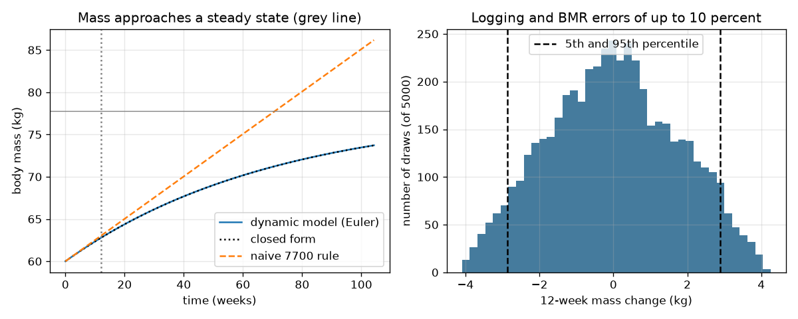

# Session 3: A dynamic model: mass approaches a steady state

*Level 3 (simulation and validation) · about 90 minutes · opennutrition*

> This is a simplified educational model. It is not a validated design tool and must not be used for real structures, electrical installations, vehicles, industrial processes or medical decisions.

**Prerequisites**

- Session 1: balance.
- Session 2: TDEE and the difference equation.
- Basic idea of an exponential (e to a power).

**Learning objectives.** After this session you can:

- Model body mass when expenditure rises with mass and show it approaches a steady state.
- Validate a numerical (Euler) solution against the closed-form exponential.
- Compare the dynamic model with the naive 7700 rule over 12 weeks and over 2 years.
- Propagate 10 percent input errors with Monte Carlo and explain a failure case.

## A. Real-world problem
Session 2 held energy use fixed. But a heavier body uses more energy, so a constant extra intake adds mass more and more slowly. How different is that from the straight-line rule, and how much can uncertain food logs and resting-energy estimates blur any prediction? This is general education only, not medical or dietary advice. The people are made up. This is a simplified model, not a clinical tool.

## B. Concept and theory
With Mifflin-St Jeor, energy use is a straight line in mass: E(M) = A M + B, where A = 10 x PAL kcal/day per kg and B = PAL x (6.25 h - 5 a + s) kcal/day. Treating mass as continuous, dM/dt = (I - A M - B) / 7700. This linear equation has an exact solution: M(t) = M_ss + (M0 - M_ss) exp(-t / tau), with steady state M_ss = (I - B) / A and time constant tau = 7700 / A. Mass moves toward M_ss and the speed is proportional to the distance still to go, so the curve flattens. A numerical Euler solution with a step of one day can be checked against this formula. The naive rule freezes E at its starting value and gives a straight line. Uncertainty: if logged intake and the BMR estimate are each off by up to 10 percent, many random draws (Monte Carlo) give a spread of outcomes. Simplifications: composition of tissue, water, hormones and behaviour are not modelled.

| Symbol | Meaning | Unit |
|---|---|---|
| M | body mass | kg |
| I | energy in per day | kcal/day |
| A, B | slope and offset of expenditure E = A M + B | kcal/day per kg, kcal/day |
| M_ss | steady-state mass | kg |
| tau | time constant | days |
| dt | time step | days |

**Assumptions**

- General education only, not medical or dietary advice; Asha is made up.
- Expenditure follows the Mifflin-St Jeor population estimate times a constant factor.
- 7700 kcal per kg is a rough rule used as the energy cost of a kg.
- Input errors are independent and uniform within plus or minus 10 percent.

$$ E(M)=A\,M+B,\quad A=10\,\mathrm{PAL},\quad B=\mathrm{PAL}\,(6.25h-5a+s) $$

$$ \frac{dM}{dt}=\frac{I-A\,M-B}{7700} $$

$$ M(t)=M_{ss}+(M_0-M_{ss})\,e^{-t/\tau},\quad M_{ss}=\frac{I-B}{A},\quad \tau=\frac{7700}{A} $$

$$ M_{n+1}=M_n+\Delta t\,\frac{I-A\,M_n-B}{7700}\quad\text{(Euler)} $$

## C. Visual explanation
The first figure (left) plots body mass over 2 years for Asha eating 2400 kcal a day: the numerical solution and the closed form lie on top of each other, the straight naive line keeps climbing, and the grey line marks the steady state that the curve approaches. The second figure (right) is a histogram of the 12-week mass change from 5000 random error draws; the dashed lines mark the 5th and 95th percentiles. The spread is wide even though the central prediction is no change.

*Left: dynamic model, closed form and naive rule. Right: spread of the 12-week mass change from 10 percent errors.*

## D. Interactive simulation
Run the lesson (`python start.py 3`), then open the live app: [Session 3: mass approaches a steady state](https://krunalpanchal1995.github.io/opennutrition/session-03/) (or `app.html` in this folder). Change intake, activity factor and the BMR error and watch the bars and the curves. Check how far the dynamic curve and the naive line differ at week 12 and later.

**Challenge.** Choose the sliders so that the steady-state mass is between 64 and 66 kg (BMR error 0, activity factor 1.55).

## E. Worked example and experiment
**Problem.** Asha (made up) is 60 kg, 165 cm, 20 years, female, PAL 1.55, and eats 2400 kcal a day. Find the steady state and the mass after 12 weeks (84 days) from the dynamic model and the naive rule.

1. A = 10 x 1.55 = 15.5 kcal/day per kg. B = 1.55 x (6.25 x 165 - 5 x 20 - 161) = 1193.89 kcal/day.
2. Starting use E0 = 15.5 x 60 + 1193.89 = 2123.9 kcal/day, so the surplus is 2400 - 2123.9 = 276.1 kcal/day.
3. Steady state M_ss = (2400 - 1193.89) / 15.5 = 77.81 kg. Time constant tau = 7700 / 15.5 = 497 days (rounded).
4. Dynamic after 84 days: 62.77 kg. Naive: 60 + 276.1 x 84 / 7700 = 63.01 kg.

**Answer.** Steady state 77.81 kg. After 12 weeks the models differ only slightly: 62.77 kg (dynamic) against 63.01 kg (naive). After 2 years they differ a lot: 73.72 kg against 86.18 kg.

**Experiment.** Weigh at the same time of day for several weeks (a made-up diary or your own practice data) and plot the 7-day average; compare its curvature with the model. In reality day-to-day water changes of about a kilogram hide the small differences at 12 weeks, appetite and activity change in response to mass, and body composition changes. The model captures the flattening only in its simplest form.

## Real-world application and mini-project: Plan a meal-and-walk schedule for a made-up person
Asha (made up) is 20, 165 cm and 60 kg, with a sedentary day. A planner wants a starting daily balance between -225 and -175 kcal. Choose meal plans from 1400, 1500, 1600 and 1700 kcal a day and walking times from 0 to 1.5 hours in 15 minute steps, using `plan_balance` from Session 3. Then simulate the best plan for 12 weeks and measure how far logging and BMR errors of up to 10 percent could move the result. This is a classroom exercise with a fictional person, not advice for anyone.

**Deliverable:** A script that lists every passing (meal kcal, walking hours) pair, picks the one with the least walking, prints its 12 week mass change from the dynamic model and the 5th to 95th percentile spread, and saves a figure of the dynamic trajectory.

**Success looks like:** The passing plans are (1500, 0.25), (1500, 0.5) and (1600, 1.0); the chosen plan (1500 kcal, 0.25 h) gives -1.85 kg in 12 weeks with a spread of about -4.03 to +0.33 kg, which shows the plan cannot be confirmed from a 12 week weigh-in alone.

## F. Assessment and design challenge
**Question type A: Conceptual.** Why does the dynamic curve flatten while the naive line does not?

Hint

What happens to energy used as mass rises?

Step-by-step solution

As mass rises, energy used rises (E = A M + B), so the gap I - E shrinks and mass changes more slowly. The naive rule freezes E at its starting value, so the gap never shrinks and the line stays straight. The curve flattens toward the steady state where E equals I.

**Question type B: Numerical.** For Asha, what steady-state mass does an intake of 2200 kcal a day give, and what fraction of the way to the steady state has the mass travelled after one time constant?

Hint

M_ss = (I - B) / A; after one tau the remaining distance is multiplied by e^-1.

Step-by-step solution

M_ss = (2200 - 1193.89) / 15.5 = 64.91 kg. After one time constant the mass has covered 1 - e^-1 = 0.632, that is 63.2 percent of the way. Sanity check: the units are kg and the answer lies between the 60 kg start and the 77.81 kg of the 2400 kcal case, as expected for a smaller intake.

**Question type C: Graph and simulation interpretation.** Reading the first figure: by how much do the naive and dynamic answers differ at 12 weeks and at 2 years (intake 2400)? What does this tell you about using the 7700 rule?

Hint

Subtract the dynamic values from the naive values.

Step-by-step solution

At 12 weeks 63.01 - 62.77 = 0.24 kg; at 2 years 86.18 - 73.72 = 12.46 kg. The rule is a fair short-term approximation but becomes very misleading when extended over long times.

**Question type D: Design and optimisation challenge.** Design: a planner for the made-up person Asha (sedentary base, 60 kg) wants a starting daily balance between -225 and -175 kcal using meal plans of 1400, 1500, 1600 or 1700 kcal and walking in 15 minute steps up to 1.5 hours. Which plans pass, which is the least walking, and can a 12-week weigh-in confirm it? State a trade-off.

Hint

Use plan_balance, find_plans, plan_outcome and plan_spread from the lesson.

Step-by-step solution

Passing plans: (1500 kcal, 0.25 h), (1500 kcal, 0.5 h) and (1600 kcal, 1.0 h). The least walking is 1500 kcal with 0.25 h: its starting balance is -181.8 kcal/day, the dynamic model predicts -1.85 kg in 12 weeks, but with 10 percent errors the 5th to 95th percentile spread is about -4.03 to +0.33 kg, so a 12-week weigh-in cannot confirm the plan. Trade-off: a bigger walk allows a larger meal, but takes more time; either way the uncertainty is larger than the effect. This is a classroom exercise, not advice.

Score yourself with [RUBRIC.md](../../RUBRIC.md). Print the [activity sheet](activity_sheet.md) to work on paper.

## Common misconceptions
| Common misconception | What is actually true |
|---|---|
| A fixed daily surplus makes mass rise in a straight line forever. | Expenditure rises with mass, so mass approaches a steady state. |
| If the model is exact in maths it is exact in life. | The solution is exact only for the model; the inputs and the model itself are uncertain. |
| Small input errors give small output errors. | A few percent in intake or BMR is hundreds of kcal a day, which over weeks is a visible change in mass. |
| Trusting the label to the last kcal is safe. | Rounding is small compared with portion errors, which dominate. |

## Glossary
- **steady state**: the mass at which energy in equals energy used
- **time constant**: the time for the remaining distance to shrink by a factor e
- **Euler method**: a simple numerical step for a differential equation
- **Monte Carlo**: estimating a spread by running the model on many random inputs
- **percentile**: the value below which a given percentage of results lie

## Finish
1. Do the three coding tasks in [exercises.md](exercises.md).
2. Run `python start.py 3` again after your changes. It ends with the checkpoint; when it prints `PASS`, you are done. (Checkpoint only: `python start.py check 3`.)

Next: the [roadmap](../../promo/roadmap.md). Session 4 is yours to build.
